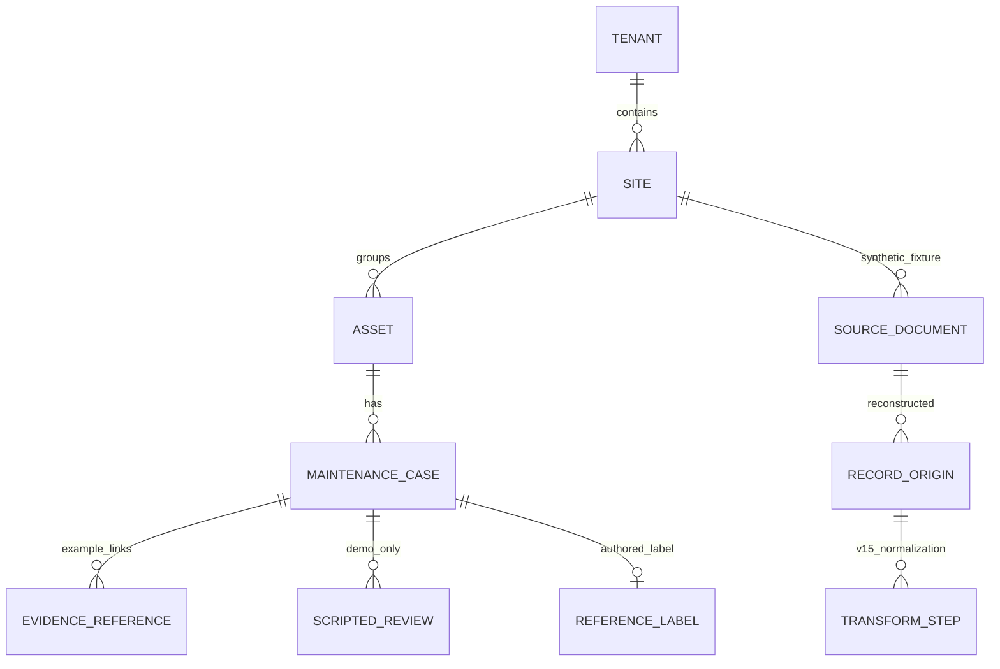

# V21 — Canonical entity and relationship design

**Controlled standard:** Mavenu AI SaaS Platform Development Architecture V4, appendix V21–V40.
**Exact objective:** Design canonical entities and relationships.
**Required proof:** Reviewed entity schema.

**Current status:** technically checkable **CANDIDATE**, independent human review PENDING. V20 data-quality sign-off and prior V10 formal phase promotion remain BLOCKED. V21 is exploratory synthetic-only Storage Data Model work, not formally authorized Phase 03, an approved migration, customer schema or deployed multi-tenant service.

## Relational design (10 entities, 9 foreign-key relationships)

| Entity | Composite identity / key | Meaning | Synthetic preview rows |
|---|---|---|---:|
| tenant | tenant_id | Fabricated namespace; not a verified customer tenant | 1 |
| site | tenant_id, site_id | Invented site grouping | 1 |
| asset | tenant_id, site_id, asset_id | Fictional equipment record | 6 |
| maintenance_case | tenant_id, site_id, case_id | Fabricated maintenance case linked to an asset | 12 |
| evidence_reference | tenant_id, site_id, case_id, evidence_ref | Example reference ID, not an authenticated document | 11 |
| scripted_review | tenant_id, site_id, case_id, reviewer_id | Test-only scripted disposition; human_executed=0 | 4 |
| reference_label | tenant_id, site_id, case_id | Authored and unadjudicated expected label | 12 |
| source_document | tenant_id, site_id, source_document_id | SHA-256 of three committed fabricated fixture files | 3 |
| record_origin | tenant_id, site_id, trace_id | Reconstructed source JSON pointer and source/derived hashes | 34 |
| transform_step | tenant_id, site_id, trace_id, step_ordinal | Three V15 normalization hash steps per case | 36 |
| **Total** | | | **120** |

Foreign keys include tenant/site scope on **eight** relationships, plus site-to-tenant. This prevents cross-site/tenant references in the *SQLite schema candidate* when foreign-key enforcement is enabled. **It is not row-level security, authentication, database grants, isolation verification, approved customer tenancy or access control.**

All ten candidate tables are WITHOUT ROWID, use explicit primary keys, and are checked against a machine-readable JSON model. Unique work-order references are scoped to tenant+site, but true canonical uniqueness and reference-data policy are deliberately deferred to V22. An origin row references a source document, while its polymorphic source dataset/key is **not backed by a dynamic FK to an asset/case/label table**; this relationship requires a V22 design decision and source-ownership approval.

## Candidate schema artifacts

- docs/data/ENTITY_MODEL_V21.json — exact entities, composite keys, relationships, expected example row counts, reference mappings, approvals and open design issues.
- docs/data/SCHEMA_DESIGN_V21.sql — candidate SQLite CREATE TABLE statements with check and foreign-key constraints. **Not** a production migration.
- scripts/entity_v21.py — read-only fixture loader, schema introspection, V16 lineage replay and isolated SQLite :memory: preview. No on-disk database.
- scripts/verify_v21.py — V10/V20 governance preflight, technical schema verification and unsigned review packet with exact SQL and model hashes.
- tests/test_entity_schema_v21.py — relational, tenancy-boundary, provenance and false-approval negative tests.

The preview verifies **120 invented entity rows**, **34 reconstructed origins**, **36 transformation steps**, **11 fictional evidence references**, **4 unexecuted reviewer script entries**, and **12 author-defined labels**. It independently reconciles the 12 synthetic maintenance cases to 163,800 example seconds and USD 1,273,500 illustrative cents. These are fabricated arithmetic, NOT actual industrial downtime or expenses.

## Explicit design review questions

1. Who owns site and tenant identities? Do they map to customer legal entities, sites, production areas, or departments? Require approved system-of-record references.
2. What constitutes a canonical asset versus equipment tag, CMMS work-order, event and case? Resolve duplicate identity and referential scope in V22.
3. Should evidence references resolve to real documents, storage objects or signed attestations? Require authorization, verification, retention and deletion rules.
4. What is the record-origin audit authority and customer legal right to access data? A V16 reconstructed source hash is not an observed ingest event or signed chain of custody.
5. Is review state a disposition log or a current-state field? Avoid inventing completed human actions from demonstration scripts.
6. Determine authoritative uptime denominator, actual timestamp, cost, account and currency precision policies before financial or reliability metrics.
7. Decide tenancy security, row-level access, encryption, retention, isolation testing and incident response; composite FKs alone are not access security.
8. Record storage-engine choice, migration up/down procedures (V23), transactional durability (V24), indexing and recovery gates (V25–V30).

## Human acceptance required

The *required proof* is a **reviewed entity schema**. The generated file evidence/V21/unsigned_entity_schema_review.json is an unsigned request, not that proof completed. A qualified architect, maintenance data steward, security reviewer and accountable product owner must inspect the model, provide identity/policy decisions, record dated approvals and residual risks. Further live system access requires customer authorization and formal resolution of V10/V20 blockers.

**Excluded:** Production database, migrations, durability, backups, customer PII, verified plant tenants/assets, operational maintenance work orders, tenant authentication, OT/CMMS/SCADA/PLC writes and realized savings.
